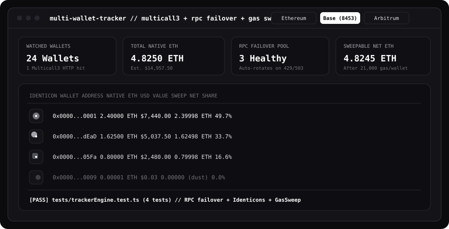

# multi-wallet-tracker


checking 30 test wallets one by one on block explorers made my fingers hurt. plus public RPC links randomly throw rate limit tantrums right when you need them. works on pure divine code and 3am adrak chai now: one Multicall3 click fetches everything at once.



## what is this

this is a fast EVM multi wallet balance dashboard built with React, Vite, and Viem.

* it fetches 1 to 100+ wallet balances in one single Multicall3 request.
* it supports Ethereum, Base, and Arbitrum out of the box with zero API keys needed.
* if one public RPC dies or rate limits you, `RpcFailoverPool` jumps to the next backup RPC automatically.
* it draws unique offline SVG avatars for every `0x` address with zero external image calls.
* it calculates exact leftover ETH you can sweep back to your main wallet after paying `21,000` gas per wallet.

## copy and run in 60 sec

```bash
git clone https://github.com/LevCodeLab/multi-wallet-tracker.git
cd multi-wallet-tracker
cp .env.example .env
npm install
npm run dev
```

to run unit tests and production build check:

```bash
npm test
npm run build
```

## how to edit files

everything is split into clean small files so you know right where to look.

* `.env.example`: set your default chain ID, custom RPC link, or default token address here.
* `src/lib/chains.ts`: add more EVM chains or swap public RPC links inside `SUPPORTED_CHAINS` here.
* `src/lib/realtimeBalanceEngine.ts`: edit Multicall3 batching, 1.5s cache timer, or ETH disperse logic here.
* `src/engine/positionEngine.ts`: edit ERC20 token balance batching and USD total math here.
* `src/lib/gasSweep.ts`: edit the `21,000` gas sweep calculator and dust filter threshold here.
* `src/lib/identicon.ts`: edit the offline geometric SVG wallet avatar shapes here.
* `src/App.tsx`: edit the dashboard table, chain buttons, and input boxes here.

## license

MIT. see [LICENSE](./LICENSE).
